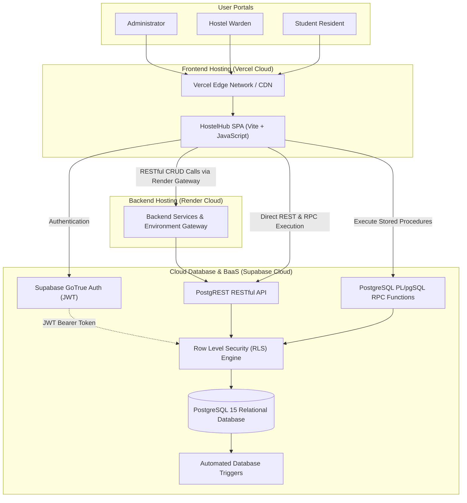
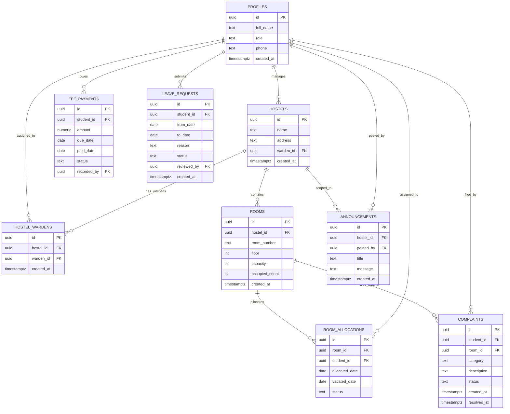

# HostelHub — Cloud-Native Hostel Management System

**Deployed Application URL**: [https://hostel-management-miyl.vercel.app/](https://hostel-management-miyl.vercel.app/)

---

## 1. Project Overview & Problem Statement

University and institutional residential hostels often struggle with fragmented manual processes, such as paper-based room allocations, untracked maintenance complaints, opaque leave authorization workflows, and disconnected fee records.

**HostelHub** is a cloud-based web application that addresses these operational challenges by automating the entire hostel administration lifecycle. The system provides real-time room capacity tracking, automated batch room allocations, digital leave requests, maintenance ticket management with automated archiving, fee tracking, and campus-wide notice broadcasting across three role-based portals: **Administrator**, **Hostel Warden**, and **Student Resident**.

---

## 2. Cloud System Architecture

The application uses a decoupled multi-cloud architecture separating client delivery, backend API routing, and cloud database management:

- **Frontend Tier (Vercel)**: Single-Page Application (SPA) hosted and globally distributed via Vercel Edge Network.
- **Backend Tier (Render)**: Backend environment and API gateway hosted on Render, handling routing and environment integration.
- **Database & BaaS Tier (Supabase)**: Managed PostgreSQL 15 database on Supabase providing authentication, automated PostgREST RESTful APIs, and PL/pgSQL stored procedures.



---

## 3. Cloud Services & Infrastructure Stack

| Layer | Provider | Role & Implementation |
| :--- | :--- | :--- |
| **Frontend Hosting** | Vercel | Edge distribution, automated continuous deployment (CI/CD) on Git push, global asset caching, and SSL/TLS termination. |
| **Backend Hosting** | Render | Cloud backend environment running application gateway services and API integration. |
| **Database & BaaS** | Supabase | Managed cloud PostgreSQL instance, database-level security policies, and user authentication. |
| **RESTful API Layer** | PostgREST | Automatic generation of OpenAPI-compliant RESTful endpoints directly from PostgreSQL schema. |
| **Identity & Auth** | Supabase Auth | User registration, password hashing (bcrypt), and signed JSON Web Token (JWT) session validation. |
| **Serverless Logic** | PL/pgSQL RPCs | Transactional stored procedures running directly inside PostgreSQL for atomic operations. |

---

## 4. Cloud Computing Concepts Demonstrated

1. **Decoupled Multi-Cloud Architecture**: Physical and logical separation between frontend hosting (Vercel), backend services (Render), and managed database storage (Supabase).
2. **Multi-Tenancy & Data Isolation**: Shared cloud database architecture isolating institutional data through Row Level Security (RLS) policies and user identity tokens (`auth.uid()`).
3. **Stateless RESTful Communication**: Standardized HTTP/JSON communication authenticated via bearer JWT tokens without server-side session bottlenecks.
4. **Backend-as-a-Service (BaaS) & Serverless Compute**: Offloaded database administration, automatic REST API generation, and serverless transactional logic executed via PL/pgSQL triggers and RPCs.
5. **Continuous Deployment (CI/CD)**: Automated production builds and global edge deployments triggered upon version-controlled repository updates.

---

## 5. Complete CRUD Operations Implementation

The application implements complete Create, Read, Update, and Delete operations across all core modules:

| Entity | Create (C) | Read (R) | Update (U) | Delete (D) |
| :--- | :--- | :--- | :--- | :--- |
| **Hostels** | Admin registers new hostel blocks and assigns wardens. | All authenticated users view hostel lists and details. | Admin modifies hostel details and warden assignments. | Admin removes hostel blocks. |
| **Rooms** | Admin/Warden creates rooms with floor and capacity limits. | Filtered views by hostel, floor, and occupancy status. | Admin/Warden edits room capacity and details. | Admin/Warden deletes unoccupied rooms. |
| **Allocations** | Warden assigns students manually or via random batch allocation. | Students view own room and roommates; Wardens view block allocations. | Warden transfers students or marks allocations as vacated. | Admin/Warden removes allocation records. |
| **Complaints** | Student files categorized complaint with description. | Student tracks own complaints; Warden/Admin reviews block complaints. | Warden updates status (`open` -> `in_progress` -> `resolved`). | Auto-archived after 10 days of resolution via trigger. |
| **Fee Payments** | Admin/Warden generates student fee invoices with due dates. | Students check fee dues and payment history; Admin/Warden monitors ledger. | Admin/Warden records payment or updates invoice amount. | Admin deletes cancelled invoices. |
| **Leave Requests** | Student submits digital leave application with date range. | Student views application status; Warden reviews pending requests. | Warden approves or rejects leave requests. | Student cancels pending applications. |
| **Announcements** | Admin/Warden posts global or hostel-specific notices. | Real-time notice feed for students and staff. | Author updates notice title and message body. | Author or Admin deletes obsolete notices. |
| **User Profiles** | Auto-created on user registration via database trigger. | Directory inspection based on administrative role. | Users update contact details; Admin promotes/demotes roles. | Admin purges deactivated accounts. |

---

## 6. RESTful API & RPC Endpoints

### RESTful Table Endpoints

| Method | Endpoint | Purpose | Access Control |
| :--- | :--- | :--- | :--- |
| `GET` / `PATCH` | `/rest/v1/profiles` | Fetch user profile or update contact details | Self / Admin / Assigned Warden |
| `GET` / `POST` / `PATCH` / `DELETE` | `/rest/v1/hostels` | Manage hostel blocks | Admin (Write), All (Read) |
| `GET` / `POST` / `PATCH` / `DELETE` | `/rest/v1/rooms` | Manage room inventories and capacities | Admin/Warden (Write), Resident (Read) |
| `GET` / `POST` / `PATCH` / `DELETE` | `/rest/v1/room_allocations` | Manage active and historical room allocations | Admin/Warden (Write), Student (Self) |
| `GET` / `POST` / `PATCH` | `/rest/v1/complaints` | File, view, and update maintenance tickets | Student (Create/Read), Warden/Admin (Update) |
| `GET` / `POST` / `PATCH` / `DELETE` | `/rest/v1/fee_payments` | Manage fee invoices and payment records | Admin/Warden (Write), Student (Self) |
| `GET` / `POST` / `PATCH` | `/rest/v1/leave_requests` | Submit, view, and review leave applications | Student (Create/Read), Warden/Admin (Update) |
| `GET` / `POST` / `PATCH` / `DELETE` | `/rest/v1/announcements` | Publish, view, and remove announcements | Admin/Warden (Write), Resident (Read) |

### PostgreSQL RPC Stored Procedures

```http
POST /rest/v1/rpc/get_dashboard_stats
POST /rest/v1/rpc/get_warden_dashboard_stats
POST /rest/v1/rpc/assign_warden_to_hostel
POST /rest/v1/rpc/update_user_role
POST /rest/v1/rpc/create_fee_record
POST /rest/v1/rpc/review_leave_request
POST /rest/v1/rpc/get_my_roommates
POST /rest/v1/rpc/random_allocate_students
```

- **`get_dashboard_stats()`**: Aggregates campus-wide metrics (occupancy rate, hostel counts, pending complaints, student total) for the Admin portal.
- **`get_warden_dashboard_stats()`**: Aggregates occupancy, pending leaves, and active complaints scoped strictly to the calling warden's assigned hostels.
- **`random_allocate_students(p_hostel_id, p_max_count)`**: Atomic, capacity-aware cursor loop allocating unassigned students to rooms with available capacity.
- **`review_leave_request(p_request_id, p_status)`**: Validates multi-tenant warden assignment before updating leave request status.
- **`update_user_role(p_user_id, p_new_role)`**: Admin-only procedure to promote or demote user roles (`student`, `warden`, `admin`).

---

## 7. Database Design & Relational Schema



### Automated Database Triggers
1. **`handle_new_user()`**: Creates a `public.profiles` record on user signup with default `'student'` role to prevent privilege escalation.
2. **`update_room_occupancy()`**: Dynamically updates `rooms.occupied_count` on allocation insert, update, or delete.
3. **`set_resolved_timestamp()`**: Sets `resolved_at = now()` when a complaint is marked resolved for retention tracking.
4. **`handle_fee_paid_date()`**: Synchronizes `paid_date` automatically when fee status changes between `'due'` and `'paid'`.
5. **`prevent_self_role_escalation()`**: Prevents non-admin users from modifying their own role column.

---

## 8. Security & Row Level Security (RLS)

### Row Level Security Policy Matrix

| Database Table | Administrator | Hostel Warden | Student Resident |
| :--- | :--- | :--- | :--- |
| **`profiles`** | Full CRUD | Read students in assigned hostels | Read and update own profile |
| **`hostels`** | Full CRUD | Read all / Manage assigned blocks | Read assigned hostel |
| **`rooms`** | Full CRUD | Manage rooms in assigned hostels | Read assigned room |
| **`room_allocations`** | Full CRUD | Manage allocations in assigned hostels | Read own active allocation & roommates |
| **`complaints`** | Full CRUD | Update status in assigned hostels | Create own / Read own complaints |
| **`fee_payments`** | Full CRUD | Manage fees for assigned students | Read own billing records |
| **`leave_requests`** | Full CRUD | Review requests for assigned students | Create own / Read own requests |
| **`announcements`** | Full CRUD | Post to assigned hostels / Read all | Read campus and hostel notices |

### Defensive Hardening Implementation
- **Search Path Pinning**: All `SECURITY DEFINER` stored procedures explicitly set `SET search_path = public, pg_temp` to neutralize search-path shadowing attacks.
- **Multi-Tenant Boundary Validation**: Stored procedures verify that wardens only manage data for students allocated to their assigned hostels (`get_my_hostel_ids()`).
- **DOM-based XSS Defense**: Dynamic client rendering uses safe DOM node methods (`textContent`, `createElement`, `appendChild`), eliminating unescaped script injection.
