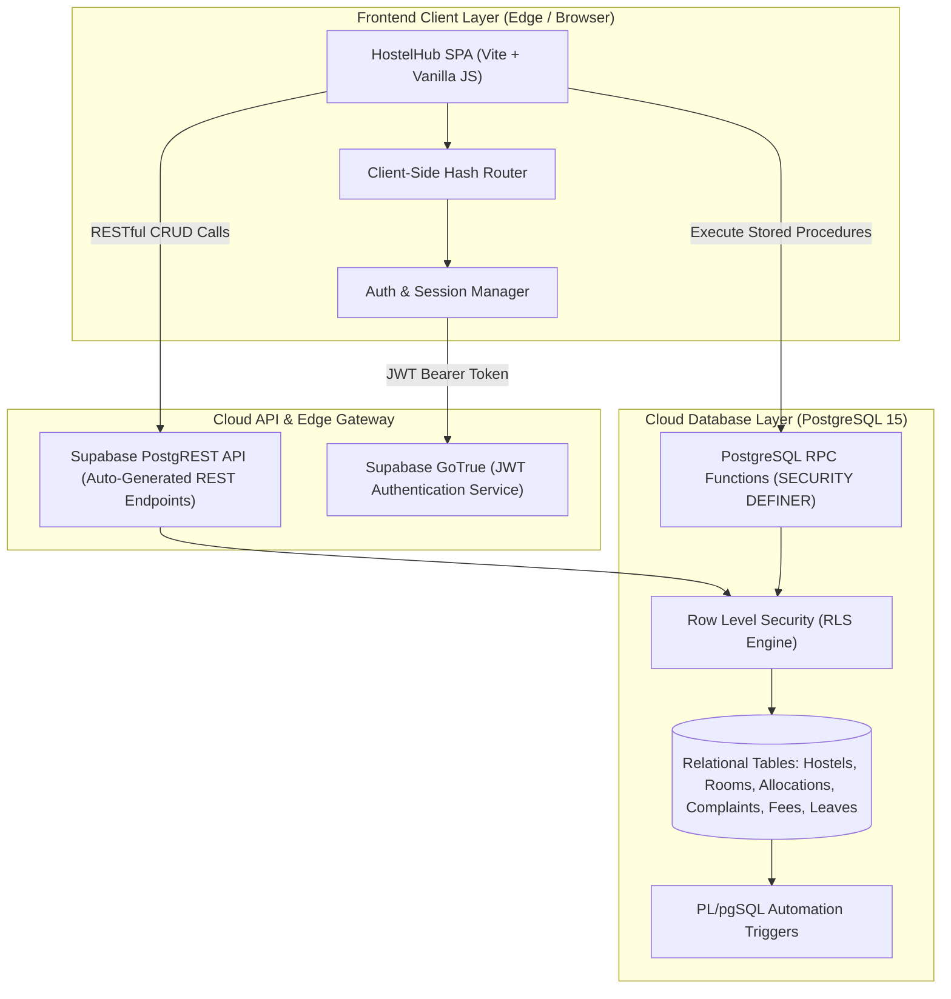
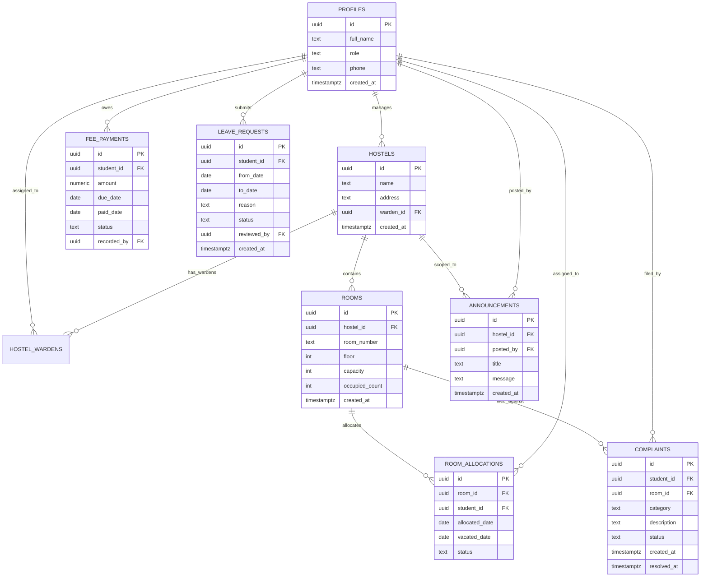

# HostelHub — Cloud-Native Hostel Management System

[](https://vitejs.dev/)
[](https://developer.mozilla.org/en-US/docs/Web/JavaScript)
[](https://supabase.com/)
[](https://www.postgresql.org/)
[](https://vercel.com/)

A modern, cloud-native **Single-Page Application (SPA)** designed for university and institutional hostel operations. Built with high performance, strict multi-tenancy, granular database-level Row Level Security (RLS), and an editorial, typography-driven user interface.

---

## Table of Contents

- [Architectural Overview](#architectural-overview)
- [Cloud Infrastructure & Services](#cloud-infrastructure--services)
- [Key Features by Role](#key-features-by-role)
- [RESTful APIs & Stored Procedures (RPCs)](#restful-apis--stored-procedures-rpcs)
- [Database Schema & Triggers](#database-schema--triggers)
- [Security & Zero-Trust Governance](#security--zero-trust-governance)
- [Design System & Typography](#design-system--typography)
- [Local Development Setup](#local-development-setup)
- [Cloud Deployment (Vercel)](#cloud-deployment-vercel)
- [Directory Structure](#directory-structure)

---

## Architectural Overview

HostelHub uses a **Backend-as-a-Service (BaaS)** cloud architecture powered by **Supabase (PostgreSQL)** and **Vite SPA (Vercel CDN)**. Business logic, data integrity, access boundaries, and authorization are enforced directly at the database engine level via PostgreSQL Row Level Security (RLS) policies, PL/pgSQL triggers, and `SECURITY DEFINER` Remote Procedure Calls (RPCs).



---

## Cloud Infrastructure & Services

| Cloud Service | Provider | Purpose in System |
| :--- | :--- | :--- |
| **Edge Hosting & CDN** | Vercel | High-availability global deployment of static web assets with automated CI/CD builds on push. |
| **Relational Database** | Supabase (AWS) | Fully managed PostgreSQL instance handling relational data, foreign key constraints, indexes, and transactional integrity. |
| **Identity & Authentication** | Supabase Auth | Secure user lifecycle management, salted password hashing, and signed JWT issuance. |
| **RESTful API Layer** | PostgREST | Instant, OpenAPI-compliant REST APIs mapped directly over PostgreSQL views, tables, and functions. |
| **Serverless Logic** | PL/pgSQL RPCs | Atomically executed database procedures for complex multi-table allocations, statistical aggregations, and role governance. |

---

## Key Features by Role

### 1. Administrator Portal
- **Campus Dashboard**: High-level statistical summaries (total hostels, aggregate room capacities, live campus occupancy percentage, open complaints, student headcount).
- **Hostel Block Management**: Create, view, update, and delete hostel blocks and assign designated wardens.
- **Room Infrastructure**: Define floors, capacities, room numbers, and inspect real-time occupancy counts.
- **Student & Role Governance**: View campus-wide student directories and promote/demote user roles (`student`, `warden`, `admin`).
- **Financial Ledger**: Issue student fee invoices, set due dates, mark manual settlements, and track overdue accounts.
- **Grievance Oversight**: Campus-wide monitoring of maintenance, hygiene, and disciplinary complaints.
- **Broadcast Announcements**: Publish global campus announcements visible to all residents and staff.

### 2. Warden Portal
- **Hostel-Scoped Dashboard**: Metrics tailored to the warden's assigned hostel blocks (vacant vs. occupied rooms, pending leave applications, unresolved complaints).
- **Room Allocation Management**: 
  - Manual student check-in / check-out.
  - **Automated Random Allocation Engine**: Batch-allocates unassigned students to available rooms within capacity limits.
- **Leave Request Processing**: Review, approve, or reject student night-out and vacation leave requests.
- **Complaint Resolution**: Update complaint statuses (`open` → `in_progress` → `resolved`) with automated 10-day auto-archive triggers.
- **Block Announcements**: Post announcements scoped exclusively to residents of their assigned hostel block.

### 3. Student Portal
- **Personal Living Space**: View assigned hostel block, room number, floor, and a privacy-safe roster of active roommates.
- **Complaints & Maintenance**: File detailed repair/cleanliness complaints with real-time status tracking.
- **Fee Management**: Review payment history, outstanding balances, due dates, and paid receipts.
- **Digital Leave Passes**: Submit leave requests with specific date ranges and justifications; track warden approval status.
- **Notice Board**: Access campus-wide broadcasts and hostel-specific notices.

---

## RESTful APIs & Stored Procedures (RPCs)

Communication between the client SPA and the cloud database leverages Supabase's PostgREST RESTful interface alongside custom PostgreSQL RPC endpoints.

### Primary RESTful Table Endpoints

| Method | Endpoint | Description | Access Boundary |
| :--- | :--- | :--- | :--- |
| `GET` / `PATCH` | `/rest/v1/profiles` | User profiles and role information | Self / Admin / Scoped Warden |
| `GET` / `POST` / `PATCH` / `DELETE` | `/rest/v1/hostels` | Hostel buildings and warden associations | Admin (CRUD), All (Read) |
| `GET` / `POST` / `PATCH` / `DELETE` | `/rest/v1/rooms` | Room details and capacity limits | Admin/Warden (Write), Resident (Read) |
| `GET` / `POST` / `PATCH` / `DELETE` | `/rest/v1/room_allocations` | Active and historical bed assignments | Admin/Warden (Manage), Student (Self) |
| `GET` / `POST` / `PATCH` | `/rest/v1/complaints` | Maintenance and facility complaints | Student (Create/Read), Warden/Admin (Update) |
| `GET` / `POST` / `PATCH` / `DELETE` | `/rest/v1/fee_payments` | Student dues and payment ledgers | Admin/Warden (Manage), Student (Self) |
| `GET` / `POST` / `PATCH` | `/rest/v1/leave_requests` | Leave requests and approvals | Student (Create/Read), Warden/Admin (Review) |
| `GET` / `POST` / `PATCH` / `DELETE` | `/rest/v1/announcements` | Campus and hostel announcements | Admin/Warden (Publish), Resident (Read) |

### PostgreSQL RPC Stored Procedures

```http
POST /rest/v1/rpc/get_dashboard_stats
POST /rest/v1/rpc/get_warden_dashboard_stats
POST /rest/v1/rpc/assign_warden_to_hostel
POST /rest/v1/rpc/update_user_role
POST /rest/v1/rpc/create_fee_record
POST /rest/v1/rpc/review_leave_request
POST /rest/v1/rpc/get_my_roommates
POST /rest/v1/rpc/random_allocate_students
```

- **`get_dashboard_stats()`**: Returns aggregate campus statistics as a JSON payload for the Admin dashboard.
- **`get_warden_dashboard_stats()`**: Aggregates room occupancy, pending leaves, and active grievances specifically for the calling warden's assigned hostels.
- **`random_allocate_students(p_hostel_id, p_max_count)`**: Atomic, capacity-aware cursor loop that pairs unallocated students with rooms possessing remaining capacity.
- **`review_leave_request(p_request_id, p_status)`**: Validates multi-tenant warden assignment before updating student leave approval status.

---

## Database Schema & Triggers



### Automated PL/pgSQL Triggers
1. **`handle_new_user()`**: Automatically bootstraps a `public.profiles` row upon new Supabase Auth registration, locking initial privilege to `'student'`.
2. **`update_room_occupancy()`**: Dynamically increments or decrements `rooms.occupied_count` whenever `room_allocations` are inserted, modified, or removed.
3. **`set_resolved_timestamp()`**: Stamps `resolved_at` when a complaint is marked as resolved, enabling clean 10-day retention filtering.
4. **`handle_fee_paid_date()`**: Synchronizes `paid_date` automatically when fee status transitions between `'due'` and `'paid'`.
5. **`prevent_self_role_escalation()`**: Guards against non-admin users attempting to alter their own `role` in `public.profiles`.

---

## Security & Zero-Trust Governance

1. **Row Level Security (RLS)**: Enforced across 100% of tables. A compromised client token cannot read or mutate records outside its RLS policy definitions.
2. **Privilege Escalation Defense**: Client registration metadata cannot override user roles. Only authenticated administrators executing RPCs can promote users.
3. **Search Path Pinning**: All `SECURITY DEFINER` functions declare `SET search_path = public, pg_temp` to eliminate PostgreSQL schema shadowing and search-path injection vulnerabilities.
4. **Cross-Tenant Boundary Enforcement**: Wardens are strictly validated against their assigned hostel IDs (`get_my_hostel_ids()`) before approving leave requests or generating fee records.
5. **DOM-based XSS Elimination**: All table cells and dynamic views render user-provided input through safe DOM APIs (`textContent`, `createElement`, `appendChild`), neutralising stored script injection.

---

## Design System & Typography

HostelHub implements the **Hallmark Lumen** design language — a warm editorial aesthetic designed for clarity and legibility.

- **Headings & Metric Numbers**: `Cormorant Garamond` (weight 500) for an elegant, dignified visual hierarchy.
- **Body & UI Elements**: `DM Sans` for high-readability text, navigation items, tables, and form inputs.
- **Labels & Badges**: `Space Mono` (11.5px, uppercase, letter-spacing: `0.15em`) for technical status chips and metadata tags.

---

## Local Development Setup

### Prerequisites
- [Node.js](https://nodejs.org/) (v18.0.0 or higher)
- [npm](https://www.npmjs.com/) (v9.0.0 or higher)
- A free [Supabase](https://supabase.com/) account

### 1. Clone & Install
```bash
git clone https://github.com/your-username/hostel-management.git
cd hostel-management
npm install
```

### 2. Environment Configuration
Create a `.env` file in the root directory:
```env
VITE_SUPABASE_URL=https://your-project-id.supabase.co
VITE_SUPABASE_ANON_KEY=your-supabase-anon-public-key
```

### 3. Database Initialization
1. Open your project in the **Supabase Dashboard**.
2. Navigate to the **SQL Editor**.
3. Copy and execute the contents of `backend/master_setup.sql` (or run the modular files in `sql/` in numerical sequence).

### 4. Start Local Development Server
```bash
npm run dev
```
Open `http://localhost:5173` in your browser.

### 5. Create Your First Administrator
1. Sign up a new user via the application interface.
2. In Supabase Dashboard -> **Table Editor** -> **`profiles`**, locate your user row.
3. Update the `role` column from `'student'` to `'admin'`.
4. Refresh the application to access the Admin Console.

---

## Cloud Deployment (Vercel)

1. Push your repository to GitHub or GitLab.
2. Log in to [Vercel](https://vercel.com/) and click **Add New Project**.
3. Import your `hostel-management` repository.
4. Under **Environment Variables**, add:
   - `VITE_SUPABASE_URL`
   - `VITE_SUPABASE_ANON_KEY`
5. Click **Deploy**. Vercel will run `npm run build` and provision your application on high-speed edge nodes.

---

## Directory Structure

```text
hostel-management/
├── backend/
│   └── master_setup.sql          # Consolidated master schema, RLS, triggers & RPCs
├── sql/
│   ├── 001_schema.sql            # Core tables, constraints & triggers
│   ├── 002_rls_policies.sql      # Row Level Security helper functions & policies
│   ├── 003_rpc_functions.sql     # Stored procedures for dashboard, allocations & roles
│   └── 004_seed.sql              # Optional test fixtures and initial seed data
├── src/
│   ├── admin/                    # Admin dashboard, hostels, rooms, wardens, students, fees
│   ├── warden/                   # Warden dashboard, allocations, leave approvals, notices
│   ├── student/                  # Student dashboard, room view, grievances, fees, leave
│   ├── components/               # Reusable UI components (table, modal, badges, layout)
│   ├── lib/                      # Supabase database query helpers & abstractions
│   ├── styles/                   # Global, layout, and component CSS design tokens
│   ├── utils/                    # Formatters, dates, and helper utilities
│   ├── auth.js                   # Client-side authentication and role management
│   ├── main.js                   # Application entry point & route bootstrapping
│   ├── router.js                 # Hash-based SPA routing engine
│   └── supabaseClient.js         # Supabase client instantiation
├── index.html                    # Root HTML file with web fonts & entry script
├── package.json                  # Dependencies, build scripts & metadata
├── vite.config.js                # Vite build and development configuration
└── README.md                     # Project documentation
```

---

## Verification & Build

To test and compile the production bundle locally:

```bash
# Execute production build
npm run build

# Preview production build locally
npm run preview
```

---

## License

This project is open-source software licensed under the **MIT License**.
